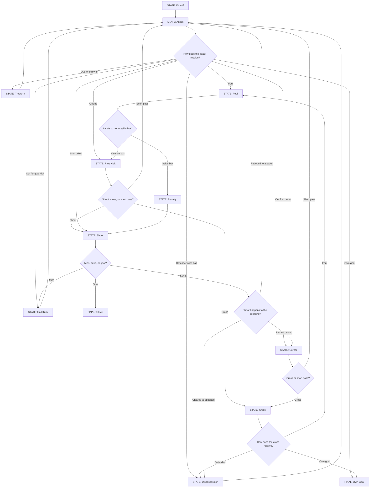

# Match Simulation - Decision Tree

This document describes the state machine used to simulate a football match, phase by phase.

## Core concept

A match is simulated as a continuous sequence of **phases**, not a fixed loop over 90 minutes. Each phase is one pass through the state machine below, starting from whatever state the previous phase ended in, and resolving into a new state that becomes the starting point of the next phase.

Each phase is assigned a **duration in minutes**. Most phases last just 1 minute, but some can last longer (e.g. after a goal, or in special cases like injury stoppages). This duration is added to the match clock, and the simulation continues until the clock reaches 90+ minutes.

Every decision in the state machine (does the attack break down, is a foul committed, does the shot result in a goal, etc.) is resolved probabilistically, based on the OVR/attributes of the players and teams involved, combined with a random roll. This keeps outcomes realistic and weighted toward the stronger side, without ever being deterministic.

## Phase state machine

## Reading the diagram

Most states feed back into each other directly (e.g. a foul outside the box leads straight back into `Free Kick`, a blocked cross leads back into `Dispossession`). Only two outcomes actually end the phase loop and reset the match to a fresh kickoff: `GOAL` and `Own Goal`. Every other outcome simply becomes the starting state of the next phase, keeping the match flowing continuously until full time.