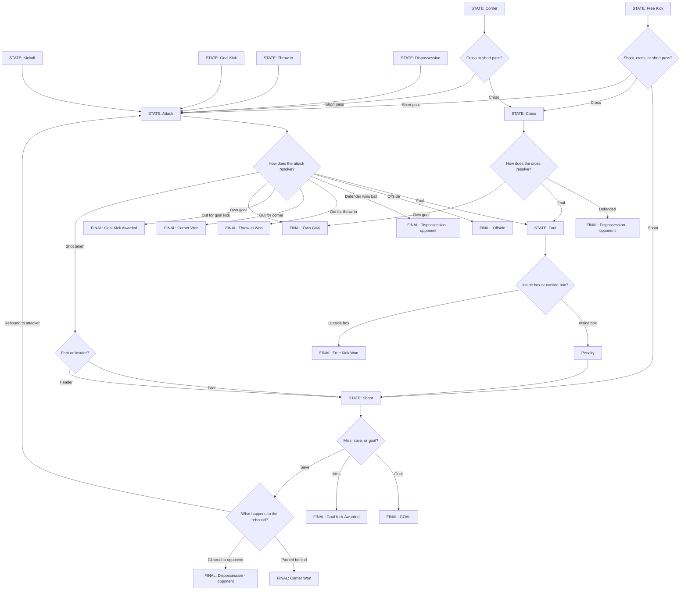

# Match Simulation - Decision Tree

## Simulation Structure

The simulation is driven by phases, not minutes:

- The match runs as a continuous loop of **phases**. Each phase is one
  pass through the state machine below, starting from whatever state the
  previous phase ended in.
- Each phase is assigned a **duration in minutes** (usually 1, but longer
  for special cases like injury stoppages or VAR checks). This duration
  is added to the match clock.
- The loop continues until the match clock reaches 90+ minutes
  (plus stoppage time).
- The minute assigned to a phase is used to timestamp any `MatchEvent`
  generated during that phase (goal, card, etc.) - it does not control
  how many phases occur, the phases themselves control how the clock
  advances.

## Phase state machine

## Notes

- **Fouls** can result from various causes (tackling, obstruction, handball) -
  all resolve identically through the `FOUL` state. The exact cause can be
  recorded as event detail for stats/display, but doesn't change the state
  transition.
- **Cards** (yellow/red) are decided independently at the `FOUL` state via a
  separate `decideCardGiven()` function. This does not affect which state
  comes next (inside/outside box still determines Penalty vs Free Kick),
  it only affects player discipline stats and, for a red card, the number
  of players remaining on the pitch for the rest of the match.
- **Own goals** are tracked separately from regular goals (`addOwnGoal()`
  instead of `addGoal()`), and credit the score to the opposing team.

## Corresponding decision functions

| Node in the diagram | Function (approximate) |
|---|---|
| Shoot, cross, or short pass? | `decideFreeKickOrCornerAction()` |
| How does the attack resolve? | `decideAttackOutcome(attackingTeam, defendingTeam)` |
| Foot or header? | `decideShotType(shooter)` |
| How does the cross resolve? | `decideCrossOutcome(winger, defender)` |
| Inside box or outside box? | `decideFoulLocation()` |
| Card for the offender? | `decideCardGiven(offender)` |
| Miss, save, or goal? | `decideShotOutcome(shooter, goalkeeper)` |
| What happens to the rebound? | `decideReboundOutcome()` |

## Implementation note

Each decision function:
1. Takes as input the relevant players for that specific situation (not the team's overall OVR)
2. Calculates a probability (using their OVR)
3. Generates a random number
4. Compares the number to the calculated probability and decides the outcome

These are built one at a time, tested in isolation, starting with the simplest
branch (attack -> shot -> goal/miss/save) before adding fouls, crosses, and
set pieces.